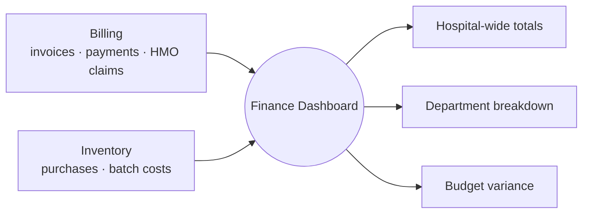

# AraCare — Finance Dashboard
### Deep Dive: Live Revenue and Expense Visibility

---

## The Problem We're Actually Solving

### Failure 1: Financial Visibility Arrives a Month Late

Revenue and spend currently surface in a monthly report, assembled after the fact from Billing and Inventory records. A department running 18% over its quarterly budget isn't discovered until the report is compiled — by which point two of the quarter's three months are already spent, and there's one month left to course-correct a problem that's been building for eight weeks.

**Result:** financial management is retrospective by default. Every budget conversation is about what already happened, never about what's happening now.

### Failure 2: Revenue and Spend Live in Different Systems With No Shared View

Billing knows what's been invoiced and collected. Inventory knows what's been spent on stock. Nobody has both in one place without manually exporting and reconciling two separate reports — which is exactly the kind of manual step that happens monthly, if at all, rather than continuously.

### Failure 3: Department-Level Attribution Gets Lost in Aggregation

A hospital-wide revenue or expense total hides which department is actually driving a shortfall. Finding out that Lab is overspending its supply budget, specifically, currently means someone manually slicing a spreadsheet by department after the fact — if the underlying records even carry that attribution cleanly.

---

## What This Module Does

1. **Reads revenue live from Billing** as invoices build and get paid — it doesn't generate or adjust figures, only reads what Billing already has
2. **Reads expenses live from Inventory** — stock purchases, batch costs, reorder transactions
3. **Aggregates both by department**, using attribution that already exists on the source records rather than re-deriving it
4. **Surfaces budget variance continuously**, so a department trending over budget is visible in week 6 of a quarter, not discovered in week 13

This module is a **leaf node** — it writes nothing back into Billing or Inventory, and no other module depends on it being available. That keeps it low-risk to build and deploy independently of the clinical path.

---

## Part 1: Data Sources and Aggregation



Both revenue and expense records already carry a department/ward tag from where they originate — a lab charge is tagged Lab at the point Billing creates it, a pharmacy dispense is tagged Pharmacy at the point Inventory decrements stock. Finance aggregates by that existing tag rather than inferring department from, say, a free-text description — which means the attribution is only as good as tagging discipline upstream, not something this module can fix on its own.

---

## Part 2: Budget Variance — The Actual Calculation

"18% over quarterly budget" is arithmetic, not a model. The original project sketch called this an "AI flag," which overstates what's happening — it's a variance calculation that happens to run continuously instead of once a month:

```
variance_pct = (actual_spend_to_date − budgeted_spend_to_date) / budgeted_spend_to_date × 100
```

**Worked example:** Pharmacy department, Q3, 6 weeks into a 13-week quarter.

```
Quarterly budget:              ₦12,000,000
Budgeted pace (linear):        ₦12,000,000 × (6/13) = ₦5,538,462
Actual spend so far:           ₦6,535,385

variance_pct = (6,535,385 − 5,538,462) / 5,538,462 × 100 = 18.0%
```

The dashboard shows: **"Pharmacy: 18% over pace for Q3."** This assumes linear budget pacing across the quarter — a department that legitimately front-loads spend early in a quarter (bulk stock purchase ahead of malaria season, say) would show as "over" in a way that isn't actually a problem. That's a labelling and interpretation issue worth surfacing to whoever reads the dashboard, not something the formula itself can resolve — see Open Questions.

**What would warrant a model later:** projecting whether a department is on track to finish the quarter over budget based on its spend *rate* so far, the same trend-projection approach as Module 8's bed prediction. Worth adding once the simple variance view is in use and trusted.

---

## Part 3: Department Attribution Rules

| Source record | Attribution comes from | Example |
| --- | --- | --- |
| Billing invoice line item | `invoice_line_items.category` (lab, pharmacy, consultation, etc.) | A lab test charge tags Lab |
| Inventory purchase/reorder | `department_id` on the stock requisition that triggered it | A pharmacy stock reorder tags Pharmacy |
| Shared/overhead costs (utilities, generator fuel) | Not attributable to a single department by default | Shown as a hospital-wide line, not forced into a department bucket (see Open Questions) |

Where attribution genuinely can't be cleanly assigned to one department, the dashboard should say so rather than guessing — a wrong attribution is worse than an honest "unallocated."

---

## Part 4: Data Models

```sql
-- Per-department, per-quarter budget figures — the one thing this module can't derive on its own
budget_lines (
  id                UUID PRIMARY KEY,
  department_id     UUID NOT NULL,
  fiscal_quarter    VARCHAR NOT NULL,          -- 'FY26-Q3'
  budgeted_amount   DECIMAL(14,2) NOT NULL,
  set_by            UUID,
  set_at            TIMESTAMP,
  notes             TEXT
)

-- Periodic snapshot of revenue, read from Billing, for fast dashboard queries
revenue_snapshots (
  id                UUID PRIMARY KEY,
  department_id     UUID NOT NULL,
  fiscal_quarter    VARCHAR NOT NULL,
  amount_to_date    DECIMAL(14,2) NOT NULL,
  source_invoice_count INTEGER,
  snapshot_at       TIMESTAMP NOT NULL
)

-- Periodic snapshot of expense, read from Inventory
expense_snapshots (
  id                UUID PRIMARY KEY,
  department_id     UUID NOT NULL,
  fiscal_quarter    VARCHAR NOT NULL,
  amount_to_date    DECIMAL(14,2) NOT NULL,
  source_transaction_count INTEGER,
  snapshot_at       TIMESTAMP NOT NULL
)

-- Computed variance, stored so the dashboard can show how it's trended over the quarter
variance_alerts (
  id                UUID PRIMARY KEY,
  department_id     UUID NOT NULL,
  fiscal_quarter    VARCHAR NOT NULL,
  budgeted_to_date  DECIMAL(14,2) NOT NULL,
  actual_to_date    DECIMAL(14,2) NOT NULL,
  variance_pct      DECIMAL(6,2) NOT NULL,
  calculated_at     TIMESTAMP NOT NULL
)
```

---

## Part 5: Access Control Model

Financial data is more sensitive than clinical operations data by default, which means this module needs a narrower access model than, say, the Capacity dashboard:

| Role | Can see |
| --- | --- |
| Hospital administrator / CMD | Hospital-wide totals and every department's breakdown |
| Department head (HOD) | Their own department's figures only |
| Finance officer | Hospital-wide totals and breakdown, plus budget-setting access |
| Clinical staff (doctor, nurse, lab, pharmacy) | No access by default — this dashboard is a management tool, not a clinical one |

This is a stricter default than the rest of AraCare, where most clinical data is visible to whoever needs it for patient care. Financial figures don't have an equivalent "needed for care" justification, so access should default to closed and be opened deliberately, not the other way around.

---

## Part 6: Nigerian Edge Cases

| Scenario | How This Module Handles It |
| --- | --- |
| **HMO claims paid weeks or months after the invoice date** | Whether a claim counts as revenue when invoiced or only when actually paid changes "live revenue" materially — flagged as an open decision (below), since Nigerian HMO payment lag is routine, not an edge case |
| **A department front-loads spend early in the quarter for legitimate reasons** | The linear-pacing assumption in Part 2 would show this as "over budget" when it may not be — the dashboard should let a department head annotate or explain a variance, not just display a bare percentage |
| **Shared costs (generator fuel, utilities) that don't belong to one department** | Shown as hospital-wide, not force-fit into a department bucket — a wrong attribution would actively mislead a department head reviewing their own numbers |
| **Cash collected at a cashier point that hasn't yet been bank-reconciled** | Finance reads what Billing has recorded as collected, not what's physically been deposited — a timing gap between cash-in-hand and bank-confirmed cash is a Billing/cashier reconciliation concern (see Module 2's own close-out process), not something Finance re-solves |
| **Equipment purchases in foreign currency (USD-denominated imports)** | Not addressed in v1 — expense snapshots assume a single currency (NGN); multi-currency purchases need a documented conversion-rate-at-time-of-purchase rule before they can be trusted in a budget comparison |

---

## Summary: Key Design Decisions

| Decision | Choice | Reason |
| --- | --- | --- |
| Revenue/expense source | Read live from Billing and Inventory | No new financial system; reuses records that already exist rather than duplicating them |
| Write access | None — read-only against both sources | Keeps Finance low-risk and independently deployable; nothing else depends on it being up |
| Variance calculation | Simple arithmetic against linear budget pacing | Matches what the sketch called an "AI flag" without the overstated complexity — this is not a prediction |
| Department attribution | Reuses existing tags from Billing/Inventory records | Avoids re-deriving attribution the source systems already capture correctly |
| Access control | Closed by default, opened deliberately per role | Financial data has no "needed for patient care" justification the way clinical data does |
| Predictive pacing model | Deferred to v2 | Worth adding once the simple variance view is in use and trusted, not before |

---

## Open Questions / Next Steps

- [ ] Where quarterly budget figures themselves come from — entered manually per department, imported from a finance system, or set once a year and never revisited?
- [ ] Reporting cadence expected by hospital leadership — does a live dashboard replace the monthly report entirely, or sit alongside it?
- [ ] Whether HMO claims should count as revenue when invoiced or only when actually received
- [ ] Whether department heads can annotate a variance (e.g. "front-loaded a bulk purchase") rather than a bare percentage standing unexplained
- [ ] How shared/overhead costs are represented without forcing a misleading department attribution
- [ ] Multi-currency handling for imported equipment purchases
