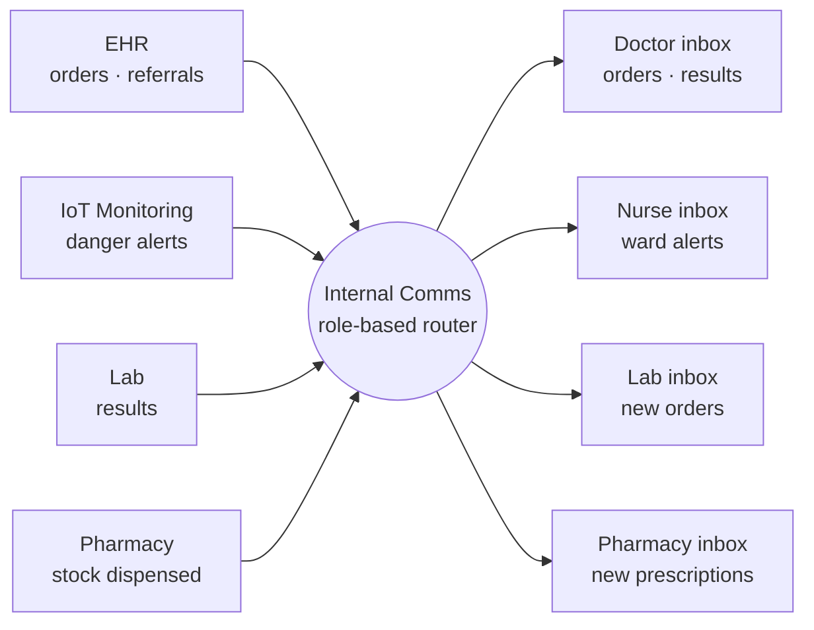

# AraCare — Internal Communications
### Deep Dive: Role-Based Clinical Messaging

---

## The Problem We're Actually Solving

### Failure 1: Paper Slips Get Lost, With No Trace That They Existed

A doctor writes a lab order on a slip, hands it to a porter, and from that point has no way to know whether it reached the lab, got dropped, or ended up on the wrong counter. If it never arrives, nobody notices — there's no system of record showing the order was ever placed, so there's nothing to notice is missing.

**Result:** a patient waits for a result that's never coming, and the gap isn't discovered until a doctor follows up manually, hours or a day later.

### Failure 2: Information Travels at Walking Speed

A critical lab value sits with the lab tech until they physically walk it to the ordering doctor's office — and if that doctor is in theatre, on another ward, or off shift, the result waits. A referral is a card carried between departments by whoever's free to carry it. None of this scales past a quiet day.

**Result:** the hospital's actual information-transfer speed is bounded by how fast a human can walk a hallway, not by how fast a diagnosis could be acted on.

### Failure 3: Nothing Is Tracked, So Nothing Is Accountable

When a prescription doesn't get filled, or a referral doesn't get followed up, there's no record of who was supposed to act on it or whether they saw it at all. Every handoff is an honor system with no audit trail — which means when something does go wrong, there's no way to find out where in the chain it broke.

---

## What This Module Does

1. **Every order, result, and alert from other modules becomes a message**, generated automatically at the moment it happens — nobody types a free-form note
2. **Messages route to a role-based inbox**, not a named person: Lab sees lab orders, Pharmacy sees prescriptions, the duty nurse sees her ward's alerts
3. **Every message carries a patient and visit ID** — nothing routes here with no clinical context
4. **Delivery and acknowledgment are tracked** — a message has a state, and nothing is considered handled just because it was sent

This is the connective tissue the rest of the system already implies but doesn't yet have a home for — it replaces the paper slip and the phone call, not the clinical decision itself.

---

## Part 1: Architecture



Messages fan in from every module that generates a clinical event and fan out to role inboxes. Nothing routes module-to-module directly — every message passes through the same tracking, linkage, and acknowledgment logic, so adding a ninth sender or a fifth role doesn't mean building a new point-to-point integration.

---

## Part 2: Message Lifecycle — State Machine

```
                    ┌─────────────┐
                    │   CREATED    │  ← generated by the sending module
                    └──────┬──────┘
                           │ routed to recipient role's inbox
                           ▼
                    ┌─────────────┐
                    │     SENT     │  ← in the recipient role's inbox
                    └──────┬──────┘
                           │ a recipient opens it
                           ▼
                    ┌─────────────┐
                    │     SEEN     │  ← viewed, not yet acted on
                    └──────┬──────┘
                           │ recipient acknowledges / acts
                           ▼
                    ┌─────────────┐
                    │ ACKNOWLEDGED │  ← closed the loop
                    └─────────────┘

         (from SENT or SEEN, if unacknowledged past its timeout)
                           │
                           ▼
                    ┌─────────────┐
                    │  ESCALATED   │  ← routed to a supervisor role, original stays open
                    └─────────────┘
```

A message being SEEN is explicitly not the same as ACKNOWLEDGED — opening a message doesn't mean it was acted on, and the state machine doesn't let "seen" quietly stand in for "handled."

---

## Part 3: Message Types

| Sender | Message | Recipient | Replaces | Urgent? |
| --- | --- | --- | --- | --- |
| EHR | Lab order | Lab inbox | Paper slip to porter | No |
| EHR | Prescription | Pharmacy inbox | Paper slip brought by patient | No |
| EHR | Internal referral | Receiving doctor's inbox | Written referral card | No |
| EHR | Admission order | Ward nurse inbox | Phone call to the ward | No |
| Lab | Result ready | Ordering doctor's inbox | Lab tech walking to the office | No |
| Lab | Critical value | Ordering doctor's inbox | Phone call | **Yes** |
| Pharmacy | Dispensed confirmation | Ordering doctor's inbox | Nothing — currently untracked | No |
| IoT Monitoring | Danger alert | Duty nurse + doctor inbox | Nothing — currently relies on a nurse noticing | **Yes** |

Only urgent messages carry an escalation timeout (Part 4) — a routine dispensed-confirmation sitting unseen for an hour isn't the same risk as a critical lab value sitting unseen for ten minutes, and treating them the same would either escalate too aggressively or not aggressively enough.

---

## Part 4: Escalation Engine

```
  Urgent message sent
         │
         ▼
  Wait for timeout window (critical value: 10 min; danger alert: 5 min)
         │
         ├── Acknowledged in time ──→ done, no escalation
         │
         └── Still unacknowledged ──→ ESCALATE
                   │
                   ▼
          Route a copy to the recipient role's supervisor
          (e.g. duty nurse unacknowledged → ward sister / shift lead)
                   │
                   ▼
          Original message stays open in the first recipient's
          inbox — escalation adds a reader, it doesn't remove
          the original recipient's responsibility
```

The escalation target (who counts as "the supervisor" for a given role) is hospital-configurable, not hardcoded — shift structures vary by department and by hospital.

---

## Part 5: Roles and Inbox Membership

A role (Doctor, Nurse, Lab, Pharmacy) is not a fixed list of named people — it's whoever is currently on shift for that function in that ward or department. This module reads shift/role membership rather than owning it:

- A message to "Nurse inbox, Ward 3" is visible to whoever is the duty nurse for Ward 3 right now
- When a shift changes, the inbox's audience changes with it — no message needs to be manually reassigned
- Cross-role visibility for handoffs (can an incoming nurse see what's still open in the outgoing nurse's view) is an open design question, not yet decided (see Open Questions)

---

## Part 6: Data Models

```sql
-- One row per message, regardless of sender type
messages (
  id                UUID PRIMARY KEY,
  patient_id        UUID REFERENCES patients(id) NOT NULL,
  visit_id          UUID REFERENCES visits(id) NOT NULL,
  sender_module     ENUM('ehr','lab','pharmacy','iot_monitoring'),
  message_type      VARCHAR NOT NULL,          -- e.g. 'lab_order', 'critical_value'
  recipient_role    ENUM('doctor','nurse','lab','pharmacy'),
  recipient_scope   VARCHAR,                   -- e.g. ward id, or specific ordering doctor id
  urgency           ENUM('routine','urgent'),
  payload           JSONB NOT NULL,            -- message-type-specific fields
  status            ENUM('created','sent','seen','acknowledged','escalated'),
  created_at        TIMESTAMP NOT NULL,
  seen_at           TIMESTAMP,
  acknowledged_at   TIMESTAMP,
  acknowledged_by   UUID
)

-- Who actually received a message — resolved from role membership at send time,
-- kept as a durable record even after shift membership changes
message_recipients (
  id                UUID PRIMARY KEY,
  message_id        UUID REFERENCES messages(id),
  staff_id          UUID NOT NULL,
  delivered_at      TIMESTAMP
)

-- Escalation events, linked back to the original message
escalations (
  id                UUID PRIMARY KEY,
  message_id        UUID REFERENCES messages(id),
  escalated_to_role VARCHAR NOT NULL,
  escalated_at      TIMESTAMP NOT NULL,
  reason            VARCHAR DEFAULT 'unacknowledged_timeout'
)

-- Per-hospital configuration for which message types escalate and how fast
escalation_rules (
  id                UUID PRIMARY KEY,
  message_type      VARCHAR NOT NULL,
  timeout_minutes   INTEGER NOT NULL,
  escalate_to_role  VARCHAR NOT NULL,
  facility_id       UUID NOT NULL
)
```

---

## Part 7: Nigerian Edge Cases

| Scenario | How This Module Handles It |
| --- | --- |
| **One shared device per ward, multiple nurses** | Inbox membership resolves to the role (duty nurse, Ward 3), not a logged-in individual — the device doesn't need per-person login to show the right messages |
| **Intermittent connectivity delaying delivery** | A message queues at the sender until it can be delivered; `status` stays `created` rather than falsely showing `sent`, so a doctor can tell the difference between "not yet delivered" and "delivered, not yet seen" |
| **Shift handover gap — outgoing nurse leaves with unacknowledged alerts** | Flagged as an open design question (cross-role visibility, Part 5) rather than assumed solved; a handover view showing the outgoing nurse's open items to the incoming one is the likely answer but isn't built yet |
| **A message needs to reach more than one recipient role at once** | Supported directly — the IoT danger alert already routes to both duty nurse and doctor inboxes as a normal case, not a special one |
| **Escalation target doesn't exist for a small department** | Escalation rules are facility-configurable per message type; a department too small to have a distinct supervisor role can point escalation at the next role up (e.g. shift lead for the whole ward, not just that specialty) |

---

## Summary: Key Design Decisions

| Decision | Choice | Reason |
| --- | --- | --- |
| Message composition | Generated automatically by sending modules | Keeps every message traceable to the clinical action that caused it; no free-form chat to moderate or lose |
| Routing target | Role, not named person | Matches how shifts actually work — membership changes without reassigning messages |
| Acknowledgment | Explicit state, separate from "seen" | Opening a message isn't the same as acting on it |
| Escalation | Timeout-based, urgent messages only | Routine messages don't need the same urgency machinery as a critical value or danger alert |
| Patient linkage | Mandatory on every message | This module routes clinical events, not general chat — a message with no patient context isn't representable |
| Module coupling | Hub-and-spoke through this module, not module-to-module | Adding a new sender or recipient role never means a new point-to-point integration |

---

## Open Questions / Next Steps

- [ ] Delivery under poor connectivity — does a message queue locally and sync, or does the sending module block until it's delivered?
- [ ] Cross-role visibility for shift handoffs — can an incoming nurse see what the outgoing nurse's inbox still has open?
- [ ] Notification channel on top of the inbox — push notification, SMS, or ward-display only, per message urgency
- [ ] Exact escalation timeouts per message type, validated against real clinical response-time expectations, not just picked
- [ ] Whether escalation rules need to vary by department (an ICU alert escalating faster than a general ward alert)
