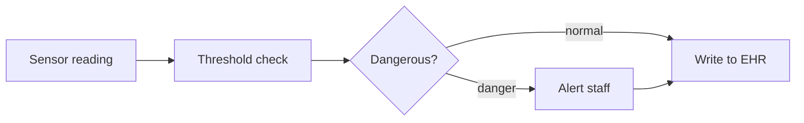

# AraCare — IoT Patient Monitoring
### Deep Dive: Continuous Bedside Sensing

---

## The Problem We're Actually Solving

### Failure 1: Vitals Are a Schedule, Not a Fact

Standard ward practice checks vitals every 4 hours. A patient whose SpO2 starts dropping at 2:15am is, by definition, not checked again until 6am — nearly four hours where nobody but the patient knows something is wrong. At a roughly 1:30 nurse-to-patient ratio, that gap isn't negligence; it's the schedule working exactly as designed, and the design is the problem.

**Result:** deterioration is caught late, by whoever happens to walk past, rather than at the moment it starts.

### Failure 2: Manual Vitals Rounds Compete With Everything Else

A nurse covering 30 patients, mid-round, who gets pulled into an emergency on another bed doesn't come back to finish the round on schedule. The 4-hour check becomes a 6-hour check becomes "whenever there's time." There's no record that it slipped — just a vitals chart with a gap nobody notices until something has already gone wrong.

**Result:** the worst nights (short-staffed, high-acuity) are exactly when manual rounds are least reliable.

### Failure 3: No One Is Watching the Patient Who Looks Fine

A patient who looks stable at 10pm and is actually trending toward respiratory distress gives no outward sign until they're acutely unwell. Manual spot-checks only catch what's happening at the moment of the check — they can't see a trend between checks, which is often where the real warning sign is.

---

## What This Module Does

1. **Bedside sensors measure SpO2, temperature, BP, and heart rate continuously** for admitted patients, not just every 4 hours
2. **Every reading is written to the EHR as an Observation** — the same record type a manual vitals entry produces, just far more frequent
3. **A reading past a danger threshold fires an alert** to the duty nurse and responsible doctor through Internal Comms, without anyone having to be at the bedside
4. **It adds a layer, it doesn't replace one** — nurse judgment and manual checks continue; this catches what happens between them

---

## Part 1: Hardware Architecture

Each bed gets one sensor unit built around an ESP32 microcontroller, chosen over imported proprietary monitors for the same reason as the rest of this build: cheap, locally available, and repairable by a local technician rather than requiring an imported replacement part and a service contract.

```
                    ┌───────────────────────────┐
                    │     BEDSIDE SENSOR UNIT     │
                    │  ┌─────────────────────┐   │
                    │  │  ESP32 microcontroller│   │
                    │  └──────────┬───────────┘   │
                    │   ┌─────────┼─────────┐     │
                    │   ▼         ▼         ▼     │
                    │ SpO2      Temp      HR       │
                    │ probe    sensor   (derived    │
                    │ (finger/  (skin     from SpO2  │
                    │  toe clip) contact) waveform)  │
                    │         ┌───────┐            │
                    │         │Battery │  backup for │
                    │         │ + Wi-Fi│  outages    │
                    │         └───────┘            │
                    └──────────────┬────────────────┘
                                   │ Wi-Fi (ward LAN)
                                   ▼
                    ┌───────────────────────────┐
                    │     WARD EDGE GATEWAY       │  ← local buffering when
                    │  (threshold check runs here) │    hospital network drops
                    └──────────────┬────────────────┘
                                   │
                                   ▼
                    ┌───────────────────────────┐
                    │   HOSPITAL BACKEND (EHR +   │
                    │      Internal Comms)         │
                    └───────────────────────────┘
```

BP is the one vital not included in v1 — automated cuffs that re-inflate on a schedule are more expensive, more failure-prone, and more disruptive to a sleeping patient than the other three sensors. Manual BP checks continue on the existing schedule; v2 can revisit automated cuffs once the simpler three-vital version is proven.

---

## Part 2: Data Flow and the Threshold Decision



Every reading is written to the EHR as an Observation whether or not it's dangerous — the full continuous record matters for later review, not just the moments something went wrong. A dangerous reading additionally fires an alert through Internal Comms (Module 9) to the duty nurse and the responsible doctor.

The threshold check runs at the ward edge gateway, not in the cloud — this keeps the alert latency low and means the danger check still works if the hospital's internet connection (not just the ward Wi-Fi) is down.

---

## Part 3: Threshold Engine

v1 uses fixed rule-based thresholds, not a predictive model — deliberately. A rule-based check is auditable (a nurse can see exactly why an alert fired), explainable to clinical staff without an ML background, and doesn't require training data this hospital doesn't have yet.

| Vital | Adult threshold | Pediatric threshold | Action |
| --- | --- | --- | --- |
| SpO2 | < 90% | < 92% | Alert |
| Temperature | > 40°C or < 35°C | > 39.5°C or < 35°C | Alert |
| Heart rate | > 140 or < 40 bpm | Age-adjusted bands (TBD) | Alert |
| Any vital | Missing/no signal > 5 min | Same | Alert (sensor fault, not necessarily patient danger) |

A missing-signal alert matters as much as a danger alert — a sensor that's fallen off or died looks identical to "nothing to report" unless it's checked for explicitly.

**v2 candidate:** an early-warning composite score (NEWS2-style, weighting multiple vitals together) once there's enough local data to validate it against actual outcomes. Adding that now would mean tuning a model with no evidence it's better calibrated for this patient population than the simple thresholds.

---

## Part 4: Alerting and Escalation

A danger alert routes to exactly two inboxes via Internal Comms: the duty nurse for that ward, and the doctor responsible for that patient. It does not page, call, or SMS directly — Internal Comms owns delivery and acknowledgment tracking (see that module's doc for escalation rules on an unacknowledged alert).

This module's only job is deciding *whether* to alert — not how the alert reaches a human. That separation means a change to notification channels (SMS vs. push vs. ward display) never requires touching the sensor pipeline.

---

## Part 5: Data Models

```sql
-- One row per physical sensor unit
sensor_devices (
  id                UUID PRIMARY KEY,
  serial_number     VARCHAR UNIQUE,
  bed_id            UUID REFERENCES beds(id),
  status            ENUM('active','offline','fault','maintenance'),
  battery_pct       INTEGER,
  last_seen_at      TIMESTAMP,
  installed_at      TIMESTAMP
)

-- Every reading, at the sampling cycle (~60s)
vital_readings (
  id                UUID PRIMARY KEY,
  sensor_device_id  UUID REFERENCES sensor_devices(id),
  visit_id          UUID REFERENCES visits(id),       -- patient in that bed at read time
  spo2              INTEGER,
  temperature_c     DECIMAL(4,1),
  heart_rate_bpm    INTEGER,
  recorded_at       TIMESTAMP NOT NULL,
  synced_at         TIMESTAMP,                        -- null while buffered offline
  ehr_observation_id UUID                              -- FK into the EHR's Observation record
)

-- Only the readings that crossed a threshold, with what fired
alert_events (
  id                UUID PRIMARY KEY,
  vital_reading_id  UUID REFERENCES vital_readings(id),
  vital             ENUM('spo2','temperature','heart_rate','signal_loss'),
  threshold_breached VARCHAR,                          -- e.g. "spo2 < 90"
  severity          ENUM('warning','critical'),
  comms_message_id  UUID,                               -- FK into Internal Comms (Module 9)
  acknowledged_at   TIMESTAMP,
  created_at        TIMESTAMP NOT NULL
)

-- Per-bed, per-patient-type threshold overrides (pediatric vs adult, documented exceptions)
threshold_profiles (
  id                UUID PRIMARY KEY,
  bed_id            UUID REFERENCES beds(id),
  patient_class     ENUM('adult','pediatric'),
  spo2_min          INTEGER,
  temp_max_c        DECIMAL(4,1),
  temp_min_c        DECIMAL(4,1),
  hr_max            INTEGER,
  hr_min            INTEGER,
  set_by            UUID,                               -- clinician who set an override, if any
  effective_from    TIMESTAMP
)
```

---

## Part 6: Power and Connectivity Resilience

Outages are routine in this environment, not exceptional, so the design has to assume them rather than treat them as a failure state:

- Each sensor unit carries battery backup sized for the hospital's typical outage duration, not just a UPS bridge-to-generator gap
- The ward edge gateway buffers readings locally when the hospital backend is unreachable, and syncs the backlog on reconnect — a gap in `synced_at` timestamps is visible and auditable, never silently dropped
- The threshold check happens at the edge specifically so alerting keeps working even when only the ward LAN is up and the wider hospital network is down

---

## Part 7: Nigerian Edge Cases

| Scenario | How This Module Handles It |
| --- | --- |
| **Power outage mid-shift** | Battery backup covers the sensor and local buffering; readings queue and sync once power/network is restored, with the gap visible in the data, not hidden |
| **Generator electrical noise interfering with sensor readings** | Flagged as a hardware validation item for pilot testing (Open Questions) — ESP32 analog inputs are sensitive to electrical noise and may need shielding or a cleaner power stage |
| **Patient movement causing false SpO2 readings** | A single bad reading shouldn't fire an alert — the threshold check should require a reading to persist (e.g. 2 consecutive cycles) before alerting, to avoid an alert fatigue problem from motion artifacts |
| **Oxygen cylinder swap disconnects a ventilated patient's monitor briefly** | Signal-loss alerting (Part 3) needs a short grace window so a routine swap doesn't trigger a false "missing signal" alert alongside the oxygen-handling itself |
| **Humidity/heat affecting sensor longevity** | Hardware sourcing should specify units rated for tropical operating conditions, not standard temperate-climate consumer electronics |
| **Multiple sensor units per ward on one Wi-Fi AP** | Ward LAN capacity needs sizing against real bed counts before rollout — not assumed to scale for free |

---

## Summary: Key Design Decisions

| Decision | Choice | Reason |
| --- | --- | --- |
| Microcontroller | ESP32 | Cheap, locally available, locally repairable |
| Vitals measured (v1) | SpO2, temperature, heart rate | Automated BP deferred — more expensive and disruptive than the value justifies for v1 |
| Danger detection | Fixed rule-based thresholds | Auditable, explainable, needs no training data; a predictive score is a v2 once data exists to validate it |
| Threshold check location | Ward edge gateway | Keeps alerting working even if the wider hospital network, not just the sensor, loses connectivity |
| Alert delivery | Routed through Internal Comms, not directly | Keeps notification-channel decisions out of the sensor pipeline |
| Offline behavior | Local buffering with visible sync gaps | Outages are routine here; silent data loss is worse than a visible gap |
| Every reading recorded | Yes, danger or not | The continuous trend has clinical value beyond the moments that crossed a threshold |

---

## Open Questions / Next Steps

- [ ] Power-outage resilience — battery backup per unit and expected runtime during an outage
- [ ] Sensor calibration and drift schedule — who checks it and how often
- [ ] Expected false-alarm rate at the chosen thresholds, and how alert fatigue is managed if it's high
- [ ] Whether readings sync in real time or batch when ward connectivity is intermittent
- [ ] Pilot validation of ESP32 analog sensor stability against hospital generator electrical noise
- [ ] Minimum-persistence rule for alerts (consecutive readings required) to suppress motion-artifact false positives
